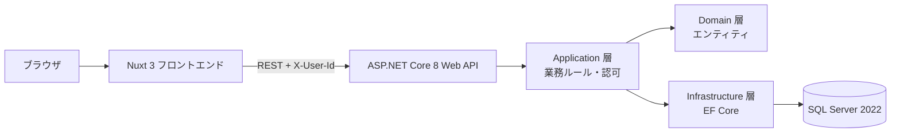

# システムアーキテクチャ設計書

| 項目 | 内容 |
|------|------|
| Doc ID | DESIGN-ARCH-001 |
| ステータス | review |
| バージョン | 1.0.0 |
| 最終更新 | 2026-10-22 |
| 基となる仕様書 | `docs/spec/` の各仕様書（SPEC-EVAL / MDC / SKILL / CAREER / 1ON1 / PROJ / NOTIF） |

---

## 1. 目的と方針

IT エンジニア向けのタレントマネジメント（考課、9ボックス、後継者計画、スキル管理、1on1、キャリア計画）を、一つの Web システムとして実現する。
このドキュメントは、機能ごとの設計書（`SPEC-*-design.md`）の上位にあたる全体構成を示す。

設計方針は次のとおり。

1. **仕様を先に書き、設計書の承認後に実装する。** 仕様書 → 設計書 → タスク → 実装 → E2E テスト → PR の順を崩さない（`CLAUDE.md` のゲートルール）。
2. **層を分ける。** API は薄く保ち、業務ルールは Application 層に集める。
3. **派生値は保存しない。** 計算で求められるものは、DB に列を持たず応答生成時に求める。

## 2. 全体構成

| 層 | 場所 | 役割 |
|---|---|---|
| Api | `backend/src/Api/` | コントローラー、ルーティング、ヘルスチェック、CORS（約30コントローラー） |
| Application | `backend/src/Application/` | ユースケース、権限判定、入力検証 |
| Domain | `backend/src/Domain/` | エンティティ（37個）と列挙型 |
| Infrastructure | `backend/src/Infrastructure/` | EF Core の DbContext、マイグレーション（15本）、シードデータ |
| フロントエンド | `frontend/` | Nuxt 3 のページ、Pinia ストア、API 呼び出しの composable |

## 3. 技術スタックと選定理由

| 領域 | 採用 | 選定理由 |
|---|---|---|
| バックエンド | ASP.NET Core 8、EF Core 8 | 実務経験のある C# の領域で、型で設計を表現しやすい |
| データベース | SQL Server 2022（Docker） | 想定する運用先の Azure SQL と互換性がある |
| フロントエンド | Nuxt 3 / Vue 3.5 / Pinia 3 / Tailwind 3 | 画面数が多いため、ファイルベースのルーティングと状態管理を使う |
| テスト | xUnit、Vitest、Playwright | 層ごと、画面ごとに、検証手段を分ける |
| 実行環境 | Docker Compose（db / backend / frontend） | 起動手順を1コマンドに揃える |
| CI | GitHub Actions | PR 時に自動でビルドとテストを回す |

却下した案と理由は、機能ごとの設計書に分散して記録している（例：`SPEC-SKILL-002-design.md`）。

## 4. 認証と認可（現状の制約）

- **認証は未実装。** 画面で選んだユーザーの ID を、API には `X-User-Id` ヘッダーで渡す、デモ用の仕組みにしている。
- **認可は実装済み。** 「配下のタレントだけを評価できる」「自分が入力した評価だけを更新できる」といった判定は、Application 層で行う。違反は 403 を返す。
- 本番の想定は Microsoft Entra ID による認証とロールベースのアクセス制御だが、**実装していない。**

## 5. データ設計

全体の関連は [er-diagram.md](./er-diagram.md) を参照。主な方針は次のとおり。

- 考課期間（`EvaluationPeriod`）を軸に履歴を管理する。
- 同一期間に同一人物の評価は1件に限る（一意制約）。
- マスタ（9ボックスのセル、スキルカテゴリ、コンピテンシー）と実績を分ける。
- 変更履歴が必要なものは、別テーブル（`UserSkillHistory` など）に残す。

## 6. 品質保証

| 種類 | 場所 | 内容 |
|---|---|---|
| バックエンド単体・結合 | `backend/tests/` | xUnit。目標、評価、スキル、結合テストなど |
| フロントエンド単体 | `frontend/tests/` | Vitest。現状は Pinia ストアの4ファイルのみ |
| E2E | `tests/e2e/` | Playwright。仕様書 ID を名前に含む30ファイル（API と UI） |
| CI | `.github/workflows/ci.yml` | 仕様書のステータスと書式の確認、.NET のビルドとテスト、Nuxt の型チェックとビルド（リントは警告のみで失敗にしない） |

仕様書の ID（例：`SPEC-MDC-002`）から、設計書、E2E テスト、PR までを追えるようにしている。E2E テストは CI には組み込んでいない（ローカルで実行する）。

## 7. 開発プロセス

仕様書 → 設計書（承認ゲート）→ タスク開始（ブランチ作成）→ 実装 → E2E テスト → PR の順で進める。
タスクは GitHub の Issue と Project で管理する。AI（Claude Code）は仕様書を読んで実装する役割で、出力は人間がレビューして承認する。

## 8. 既知の制約・今後

- 認証（Entra ID）、Azure への配備、監視は、構想のみで未実装。
- 想定ユーザーは社内のエンジニア組織。実データは含まず、シードデータは架空。
- 大量データでの性能検証は行っていない。
