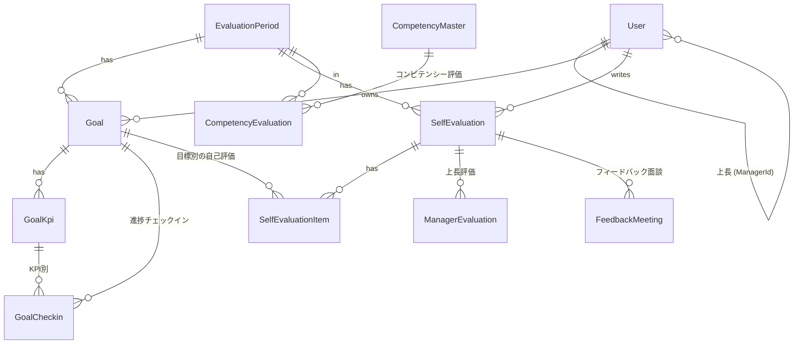
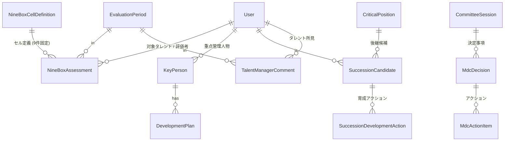
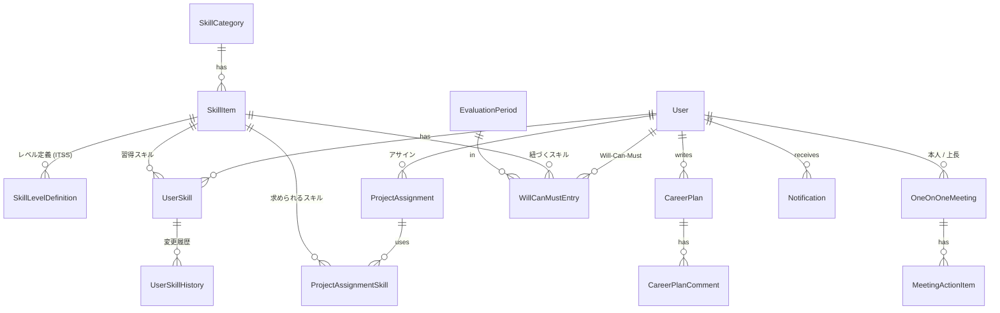

# ER 図（全体）

エンティティ（`backend/src/Domain/Entities/`、37個）の外部キー項目から作成した、主要な関連の一覧。
項目の詳細は、各機能の設計書（`docs/design/SPEC-*-design.md`）を参照。

## 評価・目標（考課フロー）

## タレントマネジメント（9ボックス・後継者・人材開発委員会）

## スキル・キャリア・1on1

## 設計上の特徴

- **期間 (`EvaluationPeriod`) を軸にした履歴管理。** 同一期間に同一タレントの評価は1件だけにする（例：9ボックスは `(TalentId, EvaluationPeriodId)` を一意にしている）。
- **派生値は DB に持たない。** 例：重点管理候補フラグは、保存せず API の応答生成時に計算する（`SPEC-MDC-002-design.md`）。
- **履歴は別テーブルに残す。** スキルの変更は `UserSkillHistory` に、スキルレベル定義の移行は `SkillLevelMigrationLog` に記録する。
- **マスタと実績を分ける。** 9ボックスのセル定義、コンピテンシー、スキルカテゴリは、マスタとして独立させている。
